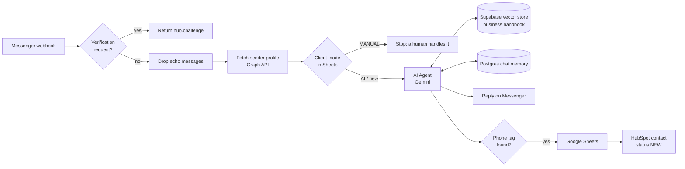

# Messenger AI Lead Capture (RAG + Phone Collection)

An AI agent that answers Facebook Messenger conversations for a business, uses the
business's own documents to persuade, and captures a valid phone number as a lead.

## Problem

Small businesses get dozens of Messenger DMs from ad campaigns. Most of them ask the
same questions, nobody replies fast enough, and the lead goes cold before anyone
gets their phone number.

## How it works

1. **Webhook entry**: one endpoint handles Meta's `GET` verification and the `POST` message events.
2. **Filtering**: echo messages (the bot's own replies) are dropped so the bot never loops on itself.
3. **Human takeover**: each sender has a mode in a Google Sheet. `MANUAL` stops the AI so an agent can take over. New senders are created in `AI` mode.
4. **AI conversation**: a Gemini agent with per-user Postgres memory and a RAG tool over the business handbook (embedded into Supabase with Gemini embeddings). The system prompt is in Arabic and pushes toward one goal: get a valid Tunisian phone number (8 digits, starting with 2/4/5/9, `+216`/`00216` stripped).
5. **Lead extraction**: when the agent outputs `[PHONE: XXXXXXXX]`, a regex pulls the number out and the lead goes to Google Sheets and HubSpot.
6. **Knowledge-base setup** (run once): download the handbook from Google Drive, split it into chunks, embed it, insert it into Supabase.

## Nodes used

| Area | Nodes |
|---|---|
| Trigger / HTTP | Webhook, Respond to Webhook, HTTP Request (Graph API v24) |
| AI | AI Agent, Google Gemini Chat Model, Embeddings Google Gemini, Postgres Chat Memory, Supabase Vector Store (retrieve-as-tool + insert), Default Data Loader |
| Logic | IF, Filter, Set, Code (JS), Stop and Error |
| Storage / CRM | Google Sheets, Google Drive, HubSpot |

## Setup

1. Import `workflow.json` into n8n.
2. Create credentials: Google Sheets/Drive OAuth2, Google Gemini API, Postgres, Supabase, HubSpot app token.
3. Replace the placeholders:
   - `YOUR_PAGE_ACCESS_TOKEN`: your Page access token. Better: put it in an n8n credential or env variable instead of the URL.
   - `YOUR_VERIFY_TOKEN`: the verify token you enter in the Meta app webhook settings.
   - `YOUR_GOOGLE_FILE_ID_*`: your leads sheet, client-modes sheet and handbook document.
   - `[BUSINESS_NAME]` / `[BUSINESS_DOMAIN]` in the AI Agent system prompt.
   - `lead@example.com` in the HubSpot node (HubSpot needs an email; map a real one if you collect it).
4. Run the document-processing branch once to fill the vector store, then activate the workflow and register the webhook URL in your Meta app.

## Results

- Replies to every Messenger lead instantly, 24/7, in Arabic.
- Answers come from the business's own handbook, not made-up claims.
- Qualified leads (validated phone numbers) land in Google Sheets and HubSpot with no manual copy-paste.
- One switch in a spreadsheet hands any conversation back to a human.
<!-- TODO: add real numbers (leads/week, response time, conversion) -->
