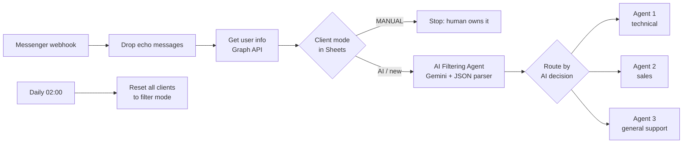

# Messenger AI Message Router

An AI triage layer for a Facebook Page inbox: it reads each incoming message,
decides which team or agent should handle it, and returns a structured JSON decision.

## Problem

One shared inbox gets technical issues, sales questions and onboarding requests all
mixed together. Routing them by hand is slow and inconsistent, and a reply from the
wrong person wastes everyone's time.

## How it works

1. **Webhook + verification**: same Meta webhook pattern as the lead-capture flow.
2. **Client mode lookup**: a Google Sheet stores a mode per sender (`AI`, `MANUAL`, or a pinned agent). New senders are created automatically.
3. **AI classification**: a Gemini agent with Postgres memory classifies the message into:
   - **Agent 1**: technical questions, bugs, account problems
   - **Agent 2**: sales, pricing
   - **Agent 3**: general support, onboarding, training

   A Structured Output Parser forces valid JSON: `assignedAgent`, `reasoning`, `confidence`.
4. **Routing**: a Switch node sends the item to the matching branch. The agent can also create or update the contact in HubSpot as a tool call.
5. **Daily reset**: a schedule trigger resets every client to filter mode at 02:00 (UTC+1) so yesterday's routing never sticks forever.

## Nodes used

| Area | Nodes |
|---|---|
| Triggers | Webhook (x2), Schedule Trigger |
| AI | AI Agent, Google Gemini Chat Model, Postgres Chat Memory, Structured Output Parser, HubSpot Tool |
| Logic | Switch (x2), IF (x2), Merge (x4), Code (JS), Set, Stop and Error |
| Data | Google Sheets (lookup / append / update), HTTP Request (Graph API) |

## Setup

1. Import `workflow.json` into n8n.
2. Create credentials: Google Sheets OAuth2, Google Gemini API, Postgres, HubSpot app token.
3. Replace the placeholders: `YOUR_PAGE_ACCESS_TOKEN`, `YOUR_VERIFY_TOKEN`, `YOUR_GOOGLE_FILE_ID_3` (client-modes sheet), `YOUR_TEST_PSID` (a test sender ID in the lookup node).
4. Plug your real handlers (a reply flow, a Slack/Telegram alert, a ticket) into the Agent 1/2/3 outputs.

## Results

- Every incoming message gets a routing decision with a reason and a confidence score.
- Structured JSON output, so routing never breaks on free-text model replies.
- Humans can take over any conversation from a spreadsheet, and modes reset every night.
<!-- TODO: add real numbers (messages routed/day, routing accuracy) -->
