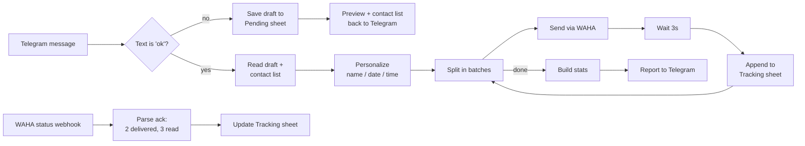

# WhatsApp Bulk Sender with Delivery Tracking

Send a personalized WhatsApp broadcast to a contact list straight from Telegram,
then track sent, delivered and read status per contact, with a stats report back in Telegram.

## Problem

Merchants want to message their customer list (promos, restock alerts, reminders)
without copy-pasting into WhatsApp one chat at a time, and they want to know who
actually received and read the message.

## How it works

1. **Draft from Telegram**: the owner sends the message text to a Telegram bot. It supports `{{name}}`, `{{date}}` and `{{time}}` placeholders.
2. **Confirm step**: the bot replies with a preview and the list of recipients. Nothing goes out until the owner replies `ok`.
3. **Send**: contacts are read from Google Sheets, phone numbers are normalized (country code `216` added), and messages go out one at a time through [WAHA](https://waha.devlike.pro/) with a 3-second delay to stay under rate limits.
4. **Tracking**: every send is logged (`Sent` / `Failed` plus error) in a tracking sheet.
5. **Status webhook**: WAHA posts message acks back to n8n. `ack 2` marks the row delivered, `ack 3` marks it read with a timestamp.
6. **Report**: when the batch finishes, Telegram gets a summary: total, sent, failed, success rate, and the names that failed.

## Nodes used

| Area | Nodes |
|---|---|
| Triggers | Telegram Trigger, Webhook (WAHA status) |
| Messaging | WAHA (`@devlikeapro/n8n-nodes-waha`), Telegram |
| Logic | Code (JS) x5, IF, Split In Batches, Wait, No-Op, Set |
| Data | Google Sheets (contacts, pending draft, tracking) |

## Setup

1. Install the community node `@devlikeapro/n8n-nodes-waha` and run a WAHA instance.
2. Import `workflow.json` and create credentials: Telegram bot, WAHA API, Google Sheets OAuth2.
3. Replace `YOUR_GOOGLE_FILE_ID_4/5/6` with your Tracking, Pending and Contacts sheets. The contacts sheet needs `nom` (name) and `numero` (phone) columns.
4. In WAHA, point the message-ack webhook to this workflow's `whatsapp-bulk-sender-tracking-webhook` URL.
5. Change the `216` country-code prefix in *Code - Prepare Messages* if your contacts are outside Tunisia.

> Only message people who opted in. For marketing at scale, use the official
> WhatsApp Business Cloud API and approved templates.

## Results

- A broadcast goes out from a single Telegram message, with a confirmation step that prevents accidental sends.
- Delivery and read receipts per contact, in a sheet the merchant can filter.
- An instant success-rate report after every campaign.
<!-- TODO: add real numbers (messages sent, delivery/read rate) -->
